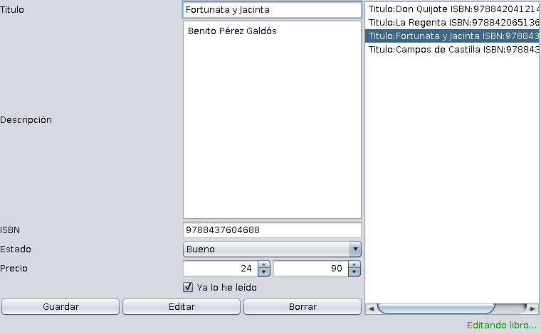
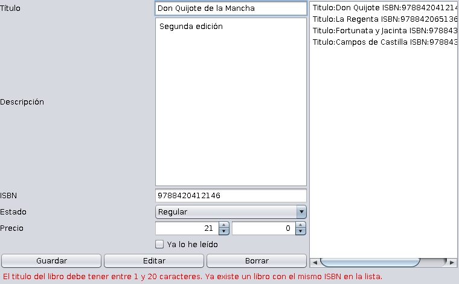
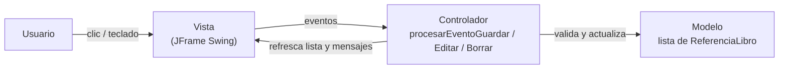

<div align="center">

# Gestor de libros con Java Swing

**Aplicación de escritorio MVC para dar de alta, editar y borrar libros desde una sola ventana, con validación de datos y atajos de teclado**


<sub>Interacción Persona-Computadora (entrega 1) · Grado en Ingeniería Informática · Universidad de Valladolid · Curso 2022-2023</sub>

</div>

<p align="center">
  
</p>

## En pocas palabras

- **Reto**: diseñar una interfaz de escritorio usable para gestionar una colección de libros, con datos validados y respuesta clara al usuario.
- **Solución**: una ventana Swing con formulario (título, ISBN, descripción, estado, precio y "leído"), lista de libros guardados y lógica separada en Modelo-Vista-Controlador.
- **Demuestra**: diseño de interfaces y usabilidad, arquitectura MVC, validación de entrada y programación orientada a eventos en Java.

## Lo más destacado

- **Arquitectura MVC**: `Modelo` guarda la lista de `ReferenciaLibro`, `Vista` es el `JFrame` y `Controlador` concentra la lógica de los eventos.
- **Validación antes de guardar**: título de 1 a 20 caracteres, ISBN de 1 a 13 y sin repetidos; además no deja cambiar el ISBN de un libro existente.
- **Un único botón para guardar**: si hay un libro seleccionado lo actualiza y, si no, lo añade; la identidad del libro es el ISBN (`equals`).
- **Uso completo con teclado**: `Supr` borra el seleccionado, `Esc` quita la selección, `1`-`9` eligen el libro de esa posición con el foco en Editar o Borrar, y `Enter` marca o desmarca "leído".
- **Retroalimentación y robustez visual**: mensajes de éxito y error en la propia ventana y tamaño mínimo fijo (600x350) para que el diseño no se rompa al redimensionar.

## Competencias

| Área | Qué se aplicó |
| --- | --- |
| Interfaces gráficas | Swing con apariencia Nimbus, `JList`, `JSpinner` y formularios del editor visual de NetBeans |
| Usabilidad (IPC) | Atajos de teclado, mensajes de retroalimentación, validación en el formulario |
| Diseño de software | Separación Modelo-Vista-Controlador, código documentado con Javadoc |
| Herramientas | Proyecto NetBeans con Ant (`build.xml`, `nbproject/`) |

## Capturas

| Edición de un libro | Validación del formulario |
| --- | --- |
|  |  |

Capturas reales de la aplicación compilada con OpenJDK 17 (`--release 11`) y ejecutada en un servidor X virtual (Xvfb), sin gestor de ventanas, por eso no aparece la barra de título. Los libros son datos de ejemplo: se rellenó el formulario y se usaron los botones **Guardar** y **Editar** de la propia aplicación.

## Arquitectura



## Estructura del repositorio

```text
IPC-entrega1/
├── build.xml  manifest.mf  nbproject/   # Proyecto NetBeans/Ant
└── src/com/entrega1/
    ├── main/Main.java                   # Arranque y look and feel
    ├── modelo/Modelo.java  ReferenciaLibro.java
    └── vista/Vista.java  Vista.form  Controlador.java
```

El precio se introduce con dos `JSpinner` (unidades y decimales) y `getPrecio()` los combina en un `double`. El estado del libro es `Malo`, `Regular` o `Bueno`.

## Requisitos

- JDK 11 o superior.
- Opcional: NetBeans o Apache Ant para usar `build.xml`.

## Cómo ejecutarlo

Abre la carpeta como proyecto en NetBeans y ejecútalo, o usa Ant:

```sh
ant run
```

<details>
<summary>Sin IDE ni Ant, solo con el JDK</summary>

```sh
javac --release 11 -d build/classes $(find src -name '*.java')
java -cp build/classes com.entrega1.main.Main
```

</details>

## Estado y limitaciones

La compilación con `javac` y el arranque de la interfaz gráfica están comprobados con OpenJDK 17 (capturas de arriba); `ant run` no se ha probado. La lista muestra el ISBN recortado cuando es largo y hay que desplazarla en horizontal. Los datos se guardan solo en memoria mientras la aplicación está abierta.

## Autoría

Proyecto en grupo. Autores de los commits: `Javier` y `jagarci` (la misma persona, Javier García González) y `hquea`.

---

<div align="center"><sub>Parte de <a href="https://github.com/JavivuG/UVa-Projects">UVa-Projects</a> · Javier García González</sub></div>
